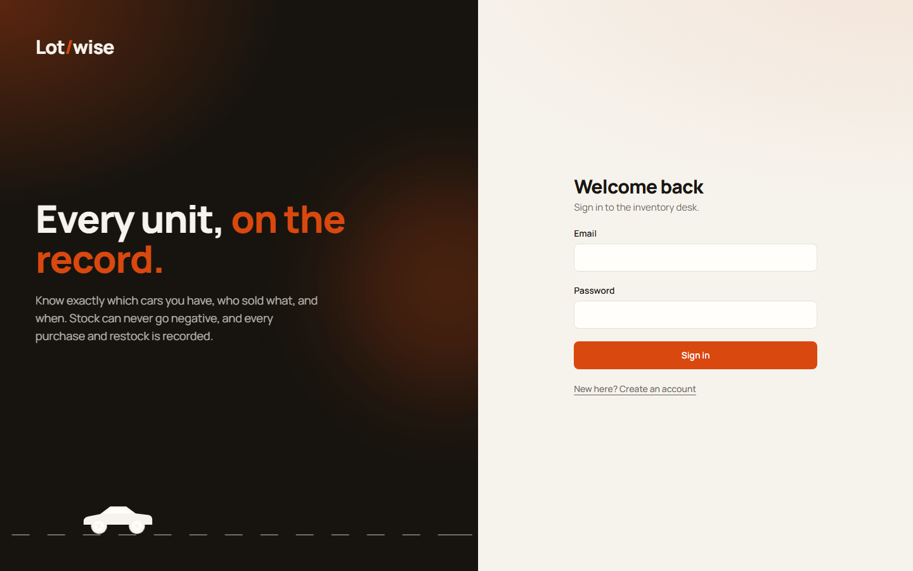
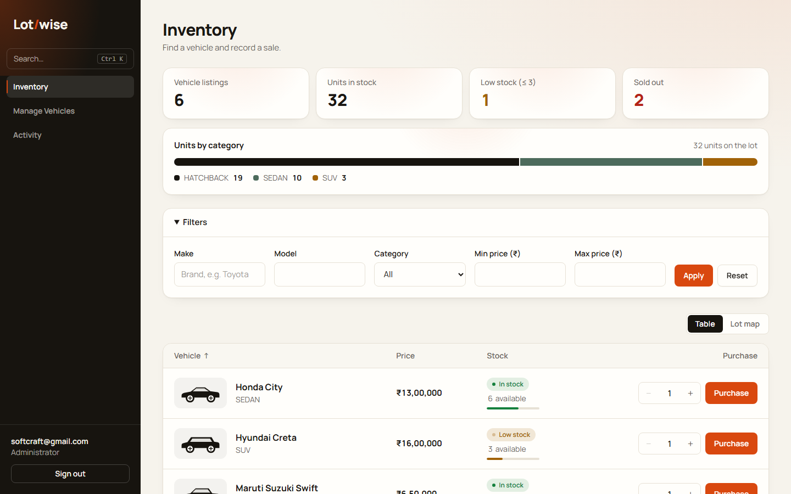
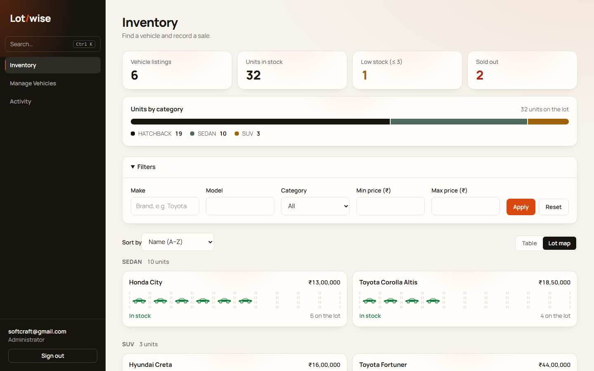
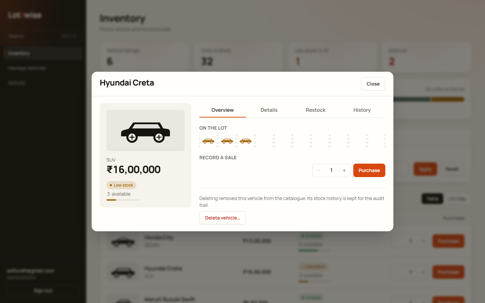
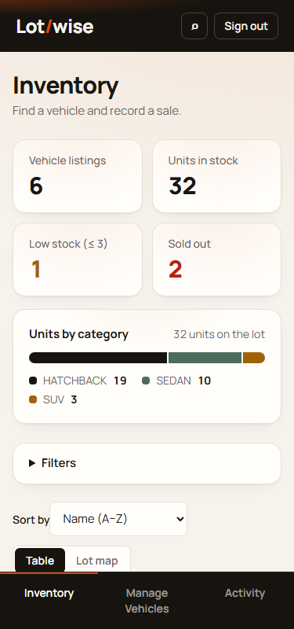

# Lotwise — Dealership Inventory System

A full-stack car dealership inventory system. Staff search the catalogue and record sales; administrators manage vehicles and stock. Every stock change is recorded in an append-only ledger, and stock can never go negative or exceed 1,000,000 units.

| Sign in | Inventory |
|---|---|
|  |  |
| **Lot map** | **Vehicle panel** |
|  |  |

Mobile (375 px): 

## Features

- Registration and login with JWT authentication; public registration always creates a `STAFF` account.
- Vehicle list and search by make, model, category and price range, with sorting and pagination. View state is kept in the URL.
- **Purchase** on every vehicle, disabled when stock is zero.
- Administrators can add, edit, restock and delete vehicles, and review the stock history (Activity).
- Concurrency-safe purchases: one conditional database update inside a transaction, so simultaneous requests cannot oversell.
- Responsive interface with a table view and a **Lot map** view, and a command palette (Ctrl + K).

## Technology

| Layer | Stack |
|---|---|
| Backend | Node.js, TypeScript, Express 5, Prisma, PostgreSQL, Zod, JWT, Argon2 |
| Frontend | React 19, TypeScript, Vite, Tailwind CSS, TanStack Query, React Router |
| Tests | Vitest, Supertest (real PostgreSQL), React Testing Library |

## Getting started

Prerequisites: Node.js 22 or later, npm, Docker.

```bash
cp .env.example .env              # set POSTGRES_PASSWORD, JWT_SECRET (32+ characters) and the seed admin
npm run install:all
npm run db:up                     # PostgreSQL on 127.0.0.1:5434
cd backend && npx prisma migrate dev && cd ..
npm run db:seed --prefix backend  # admin from SEED_ADMIN_* plus demo vehicles

npm run dev --prefix backend      # API on http://localhost:4000
npm run dev --prefix frontend     # application on http://localhost:5173
```

Sign in with the seeded administrator, or register a new staff account.

## Testing

```bash
npm test --prefix backend
npm run test:coverage --prefix backend
npm test --prefix frontend
npm run typecheck && npm run lint
```

Backend tests use an isolated `<database>_test` database that is recreated on every run. Results are in the [test report](docs/TEST_REPORT.md): 113 of 113 backend tests (98.04 % statement coverage) and 10 of 10 frontend tests.

## API

| Endpoint | Access |
|---|---|
| `POST /api/auth/register`, `POST /api/auth/login` | Public |
| `GET /api/auth/me` | Authenticated |
| `GET /api/vehicles`, `GET /api/vehicles/search` | Staff, Admin |
| `POST /api/vehicles/:id/purchase` | Staff, Admin |
| `POST /api/vehicles`, `PUT /api/vehicles/:id`, `DELETE /api/vehicles/:id` | Admin |
| `POST /api/vehicles/:id/restock`, `GET /api/vehicles/:id/movements` | Admin |
| `GET /api/health` | Public |

Design decisions:

- **Delete** hides the vehicle from the catalogue and keeps its movement history, so the audit trail stays complete.
- **Stock changes** use one conditional `UPDATE` plus a ledger insert in a single transaction. Database `CHECK` constraints back the rules.
- **Prices** are stored as integer paise; **categories** are normalised to upper case.
- **Errors** use a single envelope: `{ "error": { "code", "message" } }`.

## Project structure

```text
backend/    Express API: src/modules (auth, vehicles, inventory), prisma/, tests/
frontend/   React application: src/app, src/features (auth, vehicles, activity), src/shared
docs/       TEST_REPORT.md, screenshots/
```

## My AI Usage

**Tool:** Claude Code (Anthropic).

**Usage:** Assisted with implementation, test generation, code reviews, and debugging.

**Testing:** AI-assisted tests covered backend and frontend functionality, including concurrent purchases and transaction rollback. Backend tests passed 113/113 with 98.04% statement coverage; frontend tests passed 10/10.

**TDD:** One complete Red-Green-Refactor cycle was recorded for the maximum-stock rule. Earlier development was primarily implementation-first.

**Reflection:** This project strengthened my understanding of testing, concurrency, and code quality while reinforcing the importance of independently verifying AI-generated code.

